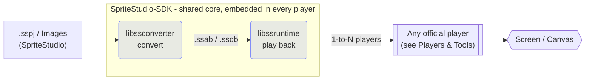

# 🌐 Ecosystem

Every official player shares one Rust core, **SpriteStudio-SDK**. A SpriteStudio project
(`.sspj`) is converted once into a compact runtime format, then played back through
`libssruntime` regardless of the target engine.

That same SDK - both conversion and playback - is embedded in every official player, so
**one shared SDK powers many players (one-to-many)**. (Each player's own docs zoom into its
specific convert/import workflow.)

<small>The highlighted **SpriteStudio-SDK** core (`libssconverter` + `libssruntime`) is what
every player builds on; the dashed hand-off is the generated **`.ssab / .ssqb`** asset. One
core drives *every* player - see [Choose Your Platform](./choose-your-platform.md) for the
current lineup.</small>

Conversion can happen **automatically on import** or via a **standalone tool** - which engines
do which, and what each route emits, is in [Converting Assets](./conversion.md).

## 🧩 The pieces

| Component | Role |
|---|---|
| **SpriteStudio-SDK** | The shared Rust core. `libssconverter` converts `.sspj` into runtime assets; `libssruntime` plays them back. Every player consumes it as a git submodule, `libssconverter` included - which is what lets some of them convert in-place. |
| **The players** (Unity, Web, Godot, Flutter, Ren'Py, wgpu, React Native) | `libssruntime` bindings plus the rendering for one engine. Those with an editor to host it in run the converter there; the rest leave conversion to the tools below ([Converting Assets](./conversion.md)). |
| **SSConverterGUI / `ssconverter-cli` / `ssconverter-web`** | Standalone front-ends over `libssconverter` for converting without a player (desktop GUI, CLI/CI, browser). |

Because conversion and playback live in the SDK, all players stay consistent in feature
support and behavior - a fix in the core benefits every platform at once.

See [SDK Concepts](../sdk/concepts.md) for what the runtime format contains, and the
[Format Specification](../sdk/format-spec.md) for the on-disk details.
