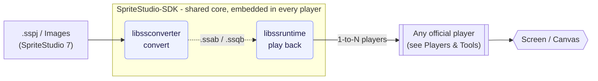

# 🌐 Ecosystem

Every official player shares one Rust core, **SpriteStudio-SDK**. A SpriteStudio project
(`.sspj`) is converted once into a compact runtime format, then played back through
`libssruntime` regardless of the target engine.

That same SDK - both conversion and playback - is embedded in every official player, so
**one shared SDK powers many players (one-to-many)**. (Each player's own docs zoom into its
specific convert/import workflow.)

<small>The highlighted **SpriteStudio-SDK** core (`libssconverter` + `libssruntime`) is what
every player builds on; the dashed hand-off is the generated **`.ssab / .ssqb`** asset. One
core drives *every* player - see [Players &amp; Tools](../players/unity.md) for the current
list.</small>

Conversion can happen **automatically on import** (Unity, Godot, Ren'Py) or via a **standalone
tool** (SSConverterGUI, `ssconverter-cli`, `ssconverter-web`). The same `libssconverter` runs
either way, so **the generated asset is identical whichever route you take**. See
[Converting Assets](./conversion.md) for the details.

## 🧩 The pieces

| Component | Role |
|---|---|
| **SpriteStudio-SDK** | The shared Rust core. `libssconverter` converts `.sspj` into runtime assets; `libssruntime` plays them back. Consumed by every player as a git submodule - including `libssconverter`, so Unity, Godot, and Ren'Py convert in-place. |
| **SSPlayerForUnity / ForGodot** | Embed `libssconverter` and run it inside the engine editor, so import & playback need no external tool. |
| **SSPlayerForRenPy** | Embeds `libssconverter` and auto-imports on startup, so no external tool is needed. |
| **SSPlayerForWeb / ForFlutter** | `libssruntime` bindings + rendering; conversion via the bundled standalone tools. ForFlutter is 🧪 in early development. |
| **SSConverterGUI / `ssconverter-cli` / `ssconverter-web`** | Standalone front-ends over `libssconverter` for converting without a player (desktop GUI, CLI/CI, browser). |

Because conversion and playback live in the SDK, all players stay consistent in feature
support and behavior - a fix in the core benefits every platform at once.

See [SDK Concepts](../sdk/concepts.md) for what the runtime format contains, and the
[Format Specification](../sdk/format-spec.md) for the on-disk details.
