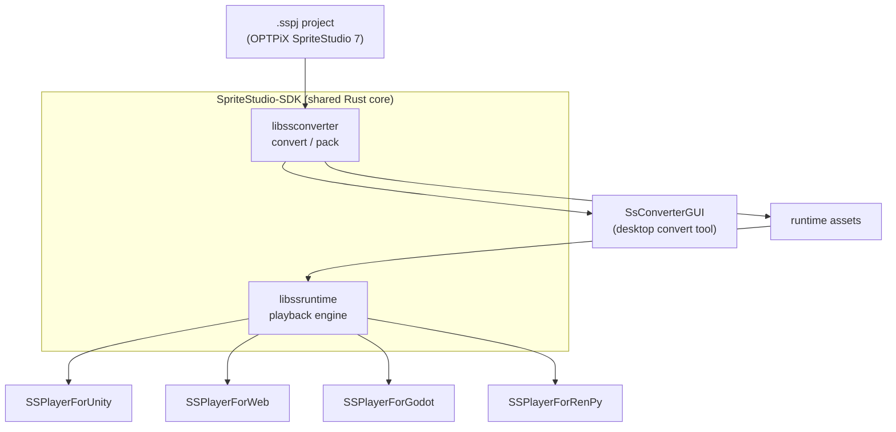

# Ecosystem

Every official player shares one Rust core, **SpriteStudio-SDK**. A SpriteStudio project
(`.sspj`) is converted once into a compact runtime format, then played back through
`libssruntime` regardless of the target engine.

## The pieces

| Component | Role |
|---|---|
| **SpriteStudio-SDK** | The shared Rust core. `libssconverter` converts `.sspj` into runtime assets; `libssruntime` plays them back. Consumed by every player as a git submodule. |
| **SSPlayerForUnity / ForWeb / ForGodot / ForRenPy** | Engine-specific bindings and rendering on top of `libssruntime`. |
| **SsConverterGUI** | A desktop front-end over `libssconverter` for converting projects without the CLI. |

Because conversion and playback live in the SDK, all players stay consistent in feature
support and behavior — a fix in the core benefits every platform at once.

See [SDK Concepts](../sdk/concepts.md) for what the runtime format contains, and the
[Format Specification](../sdk/format-spec.md) for the on-disk details.
