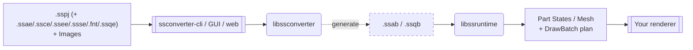

# 💡 SDK Concepts

**SpriteStudio-SDK** is a high-performance, **engine-agnostic** animation player SDK for
SpriteStudio. It computes everything needed to play a raster-based 2D animation and
hands your engine a ready-to-render plan - so a player only needs to draw, not to re-implement
SpriteStudio's animation math.

## 🔄 The workflow

1. **Convert** - turn a SpriteStudio project (`.sspj`) into an optimized binary (`.ssab`)
   with `libssconverter` (via `ssconverter-cli`, the [Converter GUI](../players/converter.md),
   `ssconverter-web`, or automatic conversion on import). See [Converting Assets](../overview/conversion.md).
2. **Play anywhere** - pass the `.ssab` to `libssruntime`. It plays *any* `.ssab`; what it
   covers is listed below, and what it does not cover yet is in [Shared Limitations](./limitations.md).

## 🧠 Brain vs. Body

`libssruntime` is the **Brain**: it evaluates keyframes for the current frame and computes
bone matrices, mesh deformation, and hierarchical color/opacity, then emits a cross-engine
**`DrawBatch` plan**. Your player is the **Body**: it reads the generated vertices and draws
the primitives. Because every renderer consumes the *same* `DrawBatch` plan, engine-specific
visual drift is structurally eliminated. (See [Porting a Player](./porting.md).)

## ✅ What the core provides

Because every official player evaluates animations with `libssruntime`, this feature set is
**shared** rather than reimplemented per engine:

- Bone hierarchies and transforms, with full keyframe interpolation (Bezier / Hermite / Linear / ...)
- Mesh & deform
- Effect parts (particles)
- Instance parts
- Masks
- 9-slice parts - the runtime builds the whole grid (margins, stretch / tile fill, repeats), so a
  player only draws the geometry it is handed
- Parts color (per-part color blending)
- Authored texture change - a per-part texture swap set on the timeline; the runtime resolves it
  into the draw batch, so a player that binds textures per batch needs no special handling
- Frame-accurate events - user data, signal, audio
- Sub-frame interpolation (smooth playback above the base frame rate)
- Whole-animation mixing / crossfade (animations stacked on tracks)
- The **Override Layer API** - override a part's color, cell reference, or visibility at runtime

!!! tip "Source of truth"
    This list follows the SDK's **Player Porting Guide**, *Introduction → Limitations*
    ([`20_limitations.md`](https://github.com/cri-middleware/SpriteStudio-SDK/blob/HEAD/libs/ssruntime/docs/10_introduction/20_limitations.md)).
    The same page draws the boundary: a couple of these are computed as **state only** and still
    need the player to draw or play them, and several carry constraints - both are summarized in
    [Shared Limitations](./limitations.md), along with what the core does *not* do yet. What
    differs between the players themselves is on
    [Player Differences](../overview/player-differences.md).

## 📚 Libraries & tools

| Component | Role |
|---|---|
| [`libsspj`](https://github.com/cri-middleware/SpriteStudio-SDK/tree/HEAD/libs/sspj) | Parses `.sspj` projects (`ssae` / `ssce` / `ssee` / `ssse` / `fnt` / `ssqe`). |
| [`libssab`](https://github.com/cri-middleware/SpriteStudio-SDK/tree/HEAD/libs/ssab) | Reads/writes the `.ssab` / `.ssqb` binary (FlatBuffers). |
| [`libssconverter`](https://github.com/cri-middleware/SpriteStudio-SDK/tree/HEAD/libs/ssconverter) | Converts `.sspj` projects into `.ssab`. |
| [`libssruntime`](https://github.com/cri-middleware/SpriteStudio-SDK/tree/HEAD/libs/ssruntime) | The playback Brain; emits the `DrawBatch` plan. |
| [`ssconverter-cli`](https://github.com/cri-middleware/SpriteStudio-SDK/tree/HEAD/cli) | Command-line converter (Windows / macOS / Linux). |

## ✨ Why this design

- **Zero-math integration & visual consistency** - the SDK does the state computation; your
  engine just renders the shared `DrawBatch`.
- **Ultra-compact payload & SIMD** - the `.ssab` format uses a columnar layout and hash-based
  lookups for near-zero parsing overhead; the runtime leverages SIMD (`f32x4`) everywhere.
- **Extreme portability** - the core is strict `#![no_std]` Rust with no OS/stdlib
  dependency; integrates via C-API or WASM, from embedded devices to browsers.
- **Sub-frame interpolation** - smooth playback beyond the base framerate (144 Hz+, slow-mo).

## ➡️ Next

- [Glossary](./glossary.md) - the vocabulary used here and in every player's docs.
- [Shared Limitations](./limitations.md) - the constraints that apply to every player.
- [Format Specification](./format-spec.md) - the `.ssab / .ssqb` binary and the runtime
  `FrameData` interface.
- [Porting a Player](./porting.md) - build a player for a new engine.
- Source of truth: [SpriteStudio-SDK](https://github.com/cri-middleware/SpriteStudio-SDK).
