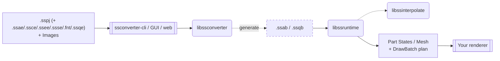

# 💡 SDK Concepts

**SpriteStudio-SDK** is a high-performance, **engine-agnostic** animation player SDK for
OPTPiX SpriteStudio 7. It computes everything needed to play a raster-based 2D animation and
hands your engine a ready-to-render plan - so a player only needs to draw, not to re-implement
SpriteStudio's animation math.

## 🔄 The workflow

1. **Convert** - turn a SpriteStudio project (`.sspj`) into an optimized binary (`.ssab`)
   with `libssconverter` (via `ssconverter-cli`, the [Converter GUI](../players/converter.md),
   `ssconverter-web`, or an in-editor importer). See [Converting Assets](../overview/conversion.md).
2. **Play anywhere** - pass the `.ssab` to `libssruntime`. It plays *any* `.ssab`, supporting
   the full SpriteStudio 7 feature set.

## 🧠 Brain vs. Body

`libssruntime` is the **Brain**: it evaluates keyframes for the current frame and computes
bone matrices, mesh deformation, and hierarchical color/opacity, then emits a cross-engine
**`DrawBatch` plan**. Your player is the **Body**: it reads the generated vertices and draws
the primitives. Because every renderer consumes the *same* `DrawBatch` plan, engine-specific
visual drift is structurally eliminated. (See [Porting a Player](./porting.md).)

## 📚 Libraries & tools

| Component | Role |
|---|---|
| [`libsspj`](https://github.com/cri-middleware/SpriteStudio-SDK/tree/main/libs/sspj) | Parses `.sspj` projects (`ssae` / `ssce` / `ssee` / `ssse` / `fnt` / `ssqe`). |
| [`libssab`](https://github.com/cri-middleware/SpriteStudio-SDK/tree/main/libs/ssab) | Reads/writes the `.ssab` / `.ssqb` binary (FlatBuffers). |
| [`libssinterpolate`](https://github.com/cri-middleware/SpriteStudio-SDK/tree/main/libs/ssinterpolate) | Platform-agnostic interpolation math. |
| [`libssconverter`](https://github.com/cri-middleware/SpriteStudio-SDK/tree/main/libs/ssconverter) | Converts `.sspj` projects into `.ssab`. |
| [`libssruntime`](https://github.com/cri-middleware/SpriteStudio-SDK/tree/main/libs/ssruntime) | The playback Brain; emits the `DrawBatch` plan. |
| [`ssconverter-cli`](https://github.com/cri-middleware/SpriteStudio-SDK/tree/main/cli) | Command-line converter (Windows / macOS / Linux). |

## ✨ Why this design

- **Zero-math integration & visual consistency** - the SDK does the state computation; your
  engine just renders the shared `DrawBatch`.
- **Ultra-compact payload & SIMD** - the `.ssab` format uses a columnar layout and hash-based
  lookups for near-zero parsing overhead; the runtime leverages SIMD (`f32x4`) everywhere.
- **Extreme portability** - the core is strict `#![no_std]` Rust with no OS/stdlib
  dependency; integrates via C-API or WASM, from embedded devices to browsers.
- **Sub-frame interpolation** - smooth playback beyond the base framerate (144 Hz+, slow-mo).

!!! note "Supported features"
    Bones & transforms, full keyframe interpolation (Bezier/Hermite/Linear/...), mesh & deform,
    particle effects, instances & masks, and frame-accurate events/user data. A runtime
    **Override Layer API** lets you override a part's color, cell reference, or visibility at
    playback time. Sequence (`.ssqe`) playback is on the roadmap - see the SDK
    [ROADMAP](https://github.com/cri-middleware/SpriteStudio-SDK/blob/main/ROADMAP.md).

## ➡️ Next

- [Format Specification](./format-spec.md) - the `.ssab / .ssqb` binary and the runtime
  `FrameData` interface.
- [Porting a Player](./porting.md) - build a player for a new engine.
- Source of truth: [SpriteStudio-SDK](https://github.com/cri-middleware/SpriteStudio-SDK).
