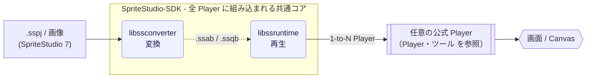

# 🌐 エコシステム

すべての公式 Player は、共通の Rust コア **SpriteStudio-SDK** を共有しています。
SpriteStudio プロジェクト（`.sspj`）は一度だけコンパクトなランタイム形式へ変換され、
対象エンジンを問わず `libssruntime` で再生されます。

変換と再生の両方を担うこの共通 SDK は、すべての公式 Player に組み込まれています。つまり
**1つの SDK が多数の Player を駆動する（一対多）**構造です。（各 Player 固有の変換・
インポート手順は、それぞれのドキュメントで詳しく扱います。）

<small>色付きの **SpriteStudio-SDK** コア（`libssconverter` + `libssruntime`）が全 Player の
基盤です。破線の受け渡しが生成物 **`.ssab / .ssqb`** です。1 つのコアが *すべての* Player を
駆動します。現行の Player の一覧は [Player・ツール](../players/unity.md) を参照して
ください。</small>

変換は **インポート時の自動変換**（Unity・Godot・Ren'Py）でも、**スタンドアロンツール**
（SSConverterGUI / `ssconverter-cli` / `ssconverter-web`）でも行えます。いずれも同じ
`libssconverter` が動くため、**生成されるアセットは経路によらず同一**です。詳細は
[アセットの変換](./conversion.md) を参照してください。

## 🧩 構成要素

| コンポーネント | 役割 |
|---|---|
| **SpriteStudio-SDK** | 共通の Rust コア。`libssconverter` が `.sspj` をランタイムアセットへ変換し、`libssruntime` が再生します。各 Player が git submodule として参照し、`libssconverter` も含むため、Unity・Godot・Ren'Py はその場で変換できます。 |
| **SSPlayerForUnity / ForGodot** | `libssconverter` を内蔵し、エンジンエディタ内で動くため、インポートも再生も外部ツール不要です。 |
| **SSPlayerForRenPy** | `libssconverter` を内蔵し、起動時に自動インポートするため外部ツール不要です。 |
| **SSPlayerForWeb / ForFlutter** | `libssruntime` バインディングと描画。変換は同梱のスタンドアロンツールで行います。ForFlutter は 🧪 開発初期です。 |
| **SSConverterGUI / `ssconverter-cli` / `ssconverter-web`** | Player を介さず変換するための `libssconverter` スタンドアロンフロントエンド（デスクトップ GUI／CLI・CI／ブラウザ）。 |

変換と再生を SDK に集約しているため、全 Player で機能サポートと挙動が一貫します。
コアの修正はすべてのプラットフォームに同時に反映されます。

ランタイム形式の内容は [SDK コンセプト](../sdk/concepts.md) を、ディスク上の詳細は
[フォーマット仕様](../sdk/format-spec.md) を参照してください。
