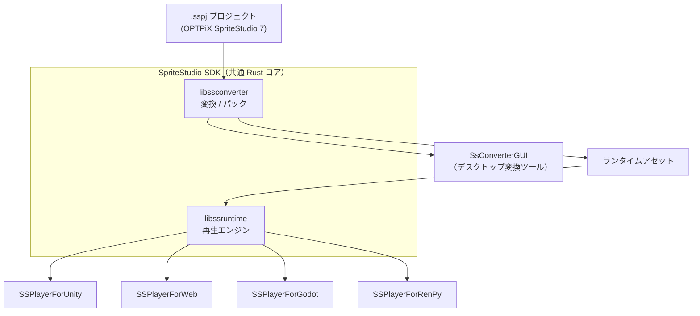

# エコシステム

すべての公式プレイヤーは、共通の Rust コア **SpriteStudio-SDK** を共有しています。
SpriteStudio プロジェクト（`.sspj`）は一度だけコンパクトなランタイム形式へ変換され、
対象エンジンを問わず `libssruntime` で再生されます。

## 構成要素

| コンポーネント | 役割 |
|---|---|
| **SpriteStudio-SDK** | 共通の Rust コア。`libssconverter` が `.sspj` をランタイムアセットへ変換し、`libssruntime` が再生します。各プレイヤーが git submodule として参照します。 |
| **SSPlayerForUnity / ForWeb / ForGodot / ForRenPy** | `libssruntime` の上に構築された、エンジン固有のバインディングと描画。 |
| **SsConverterGUI** | CLI を使わずにプロジェクトを変換できる、`libssconverter` のデスクトップフロントエンド。 |

変換と再生を SDK に集約しているため、全プレイヤーで機能サポートと挙動が一貫します。
コアの修正はすべてのプラットフォームに同時に反映されます。

ランタイム形式の内容は [SDK コンセプト](../sdk/concepts.md) を、ディスク上の詳細は
[フォーマット仕様](../sdk/format-spec.md) を参照してください。
