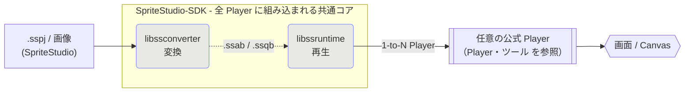

# 🌐 エコシステム

すべての公式 Player は、共通の Rust コア **SpriteStudio-SDK** を共有しています。
SpriteStudio プロジェクト（`.sspj`）は一度だけコンパクトなランタイム形式へ変換され、対象エンジンを問わず `libssruntime` で再生されます。

<small>色付きの **SpriteStudio-SDK** コア（`libssconverter` + `libssruntime`）が全 Player の基盤です。破線の受け渡しが生成物 **`.ssab / .ssqb`** です。現行の Player のラインナップは
[プラットフォームの選び方](./choose-your-platform.md) を参照してください。</small>

変換は **インポート時の自動変換**でも、**スタンドアロンツール**でも行えます。どのエンジンがどちらで、それぞれが何を出力するかは [アセットの変換](./conversion.md) にまとめてあります。

## 🧩 構成要素

| コンポーネント | 役割 |
|---|---|
| **SpriteStudio-SDK** | 共通の Rust コア。`libssconverter` が `.sspj` をランタイムアセットへ変換し、`libssruntime` が再生します。各 Player が git submodule として参照し、`libssconverter` も含むため、その場で変換できる Player があります。 |
| **各 Player** | `libssruntime` のバインディングと、そのエンジン向けの描画。開発中の変換まで担うものもあり（どれがそうかは [アセットの変換](./conversion.md) にあります）、それ以外は変換を下記のツールに任せます。 |
| **SSConverter GUI / `ssconverter-cli` / `ssconverter-web`** | Player を介さず変換するための `libssconverter` スタンドアロンフロントエンド（デスクトップ GUI／CLI・CI／ブラウザ）。 |

変換と再生を SDK に集約しているため、全 Player で機能サポートと挙動が一貫します。コアの修正はすべてのプラットフォームに同時に反映されます。

ランタイム形式の内容は [SDK コンセプト](../sdk/concepts.md) を、ディスク上の詳細は
[フォーマット仕様](../sdk/format-spec.md) を参照してください。
