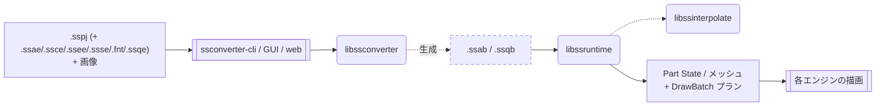

# 💡 SDK コンセプト

**SpriteStudio-SDK** は、OPTPiX SpriteStudio 7 向けの高性能かつ**エンジン非依存**な
アニメーション再生 SDK です。ラスターベースの 2D アニメ再生に必要な計算をすべて行い、
そのまま描画できるプランをエンジンへ渡します。 Player は「描画するだけ」で済み、SpriteStudio の
アニメーション計算を再実装する必要はありません。

## 🔄 ワークフロー

1. **変換** - SpriteStudio プロジェクト（`.sspj`）を `libssconverter` で最適化バイナリ
   （`.ssab`）へ変換（`ssconverter-cli` / [Converter GUI](../players/converter.md) /
   `ssconverter-web` / エディタ内蔵インポーター経由）。[アセットの変換](../overview/conversion.md) を参照。
2. **どこでも再生** - `.ssab` を `libssruntime` に渡すだけ。*あらゆる* `.ssab` を再生でき、
   SpriteStudio 7 のフルセットに対応します。

## 🧠 Brain と Body

`libssruntime` が **Brain**（頭脳）です。現在フレームのキーフレームを評価し、ボーン行列・
メッシュ変形・階層的なカラー／不透明度を計算して、エンジン共通の **`DrawBatch` プラン**を
出力します。 Player は **Body**（身体）で、生成された頂点を読んでプリミティブを描画します。
すべての描画側が *同じ* `DrawBatch` プランを消費するため、エンジン固有の見た目のズレが
構造的に排除されます。（[Player の移植](./porting.md) を参照。）

## 📚 ライブラリとツール

| コンポーネント | 役割 |
|---|---|
| [`libsspj`](https://github.com/cri-middleware/SpriteStudio-SDK/tree/main/libs/sspj) | `.sspj` プロジェクト（`ssae` / `ssce` / `ssee` / `ssse` / `fnt` / `ssqe`）の解析。 |
| [`libssab`](https://github.com/cri-middleware/SpriteStudio-SDK/tree/main/libs/ssab) | `.ssab` / `.ssqb` バイナリの読み書き（FlatBuffers）。 |
| [`libssinterpolate`](https://github.com/cri-middleware/SpriteStudio-SDK/tree/main/libs/ssinterpolate) | プラットフォーム非依存の補間演算。 |
| [`libssconverter`](https://github.com/cri-middleware/SpriteStudio-SDK/tree/main/libs/ssconverter) | `.sspj` を `.ssab` へ変換。 |
| [`libssruntime`](https://github.com/cri-middleware/SpriteStudio-SDK/tree/main/libs/ssruntime) | 再生の Brain。`DrawBatch` プランを出力。 |
| [`ssconverter-cli`](https://github.com/cri-middleware/SpriteStudio-SDK/tree/main/cli) | コマンドライン変換ツール（Windows / macOS / Linux）。 |

## ✨ この設計の利点

- **計算不要の統合と見た目の一貫性** - 状態計算は SDK が担い、エンジンは共通の `DrawBatch`
  を描画するだけ。
- **超コンパクトなペイロードと SIMD** - `.ssab` は列指向レイアウトとハッシュルックアップで
  パース負荷ほぼゼロ。ランタイムは各環境で SIMD（`f32x4`）を活用。
- **極めて高い移植性** - コアは厳格な `#![no_std]` Rust で OS／標準ライブラリに非依存。
  C-API や WASM で組み込め、組込機器からブラウザまで動作。
- **サブフレーム補間** - 基準フレームレートを超える滑らかな再生（144Hz+・スローモーション）。

!!! note "対応機能"
    ボーン・トランスフォーム、各種キーフレーム補間（Bezier/Hermite/Linear ほか）、メッシュ&
    デフォーム、パーティクル、インスタンス・マスク、フレーム精度のイベント／ユーザーデータ。
    シーケンス（`.ssqe`）再生はロードマップ上です - SDK の
    [ROADMAP](https://github.com/cri-middleware/SpriteStudio-SDK/blob/main/ROADMAP.md) を参照。

## ➡️ 次に

- [フォーマット仕様](./format-spec.md) - `.ssab / .ssqb` バイナリとランタイムの `FrameData` インターフェース。
- [Player の移植](./porting.md) - 新規エンジン向けの Player を作る。
- 一次情報: [SpriteStudio-SDK](https://github.com/cri-middleware/SpriteStudio-SDK)。
