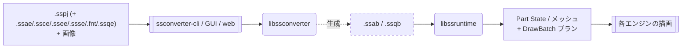

# 💡 SDK コンセプト

**SpriteStudio-SDK** は、OPTPiX SpriteStudio 7 向けの高性能かつ**エンジン非依存**な
アニメーション再生 SDK です。ラスターベースの 2D アニメ再生に必要な計算をすべて行い、
そのまま描画できるプランをエンジンへ渡します。 Player は「描画するだけ」で済み、SpriteStudio の
アニメーション計算を再実装する必要はありません。

## 🔄 ワークフロー

1. **変換** - SpriteStudio プロジェクト（`.sspj`）を `libssconverter` で最適化バイナリ
   （`.ssab`）へ変換（`ssconverter-cli` / [Converter GUI](../players/converter.md) /
   `ssconverter-web` / インポート時の自動変換）。[アセットの変換](../overview/conversion.md) を参照。
2. **どこでも再生** - `.ssab` を `libssruntime` に渡すだけ。*あらゆる* `.ssab` を再生でき、
   SpriteStudio 7 のフルセットに対応します。

## 🧠 Brain と Body

`libssruntime` が **Brain**（頭脳）です。現在フレームのキーフレームを評価し、ボーン行列・
メッシュ変形・階層的なカラー／不透明度を計算して、エンジン共通の **`DrawBatch` プラン**を
出力します。 Player は **Body**（身体）で、生成された頂点を読んでプリミティブを描画します。
すべての描画側が *同じ* `DrawBatch` プランを消費するため、エンジン固有の見た目のズレが
構造的に排除されます。（[Player の移植](./porting.md) を参照。）

## ✅ コアが提供する機能

すべての公式 Player は `libssruntime` でアニメーションを評価します。したがって以下の機能セットは
エンジンごとに作り直されるのではなく **共有** されています。

- ボーン階層とトランスフォーム、および全補間方式のキーフレーム補間（Bezier / Hermite / Linear ほか）
- メッシュ・デフォーム
- エフェクトパーツ（パーティクル）
- インスタンスパーツ
- マスク
- 9 スライスパーツ - マージン、ストレッチ／タイルの塗り方、繰り返しを含むグリッド全体を
  ランタイムが構築するため、Player は渡された頂点を描画するだけで済みます
- パーツカラー（パーツ単位のカラーブレンド）
- 作画で指定するテクスチャ変更（TextureChange） - タイムライン上でパーツ単位にテクスチャを
  差し替えます。ランタイムが評価して描画バッチに反映するため、バッチ単位でテクスチャを
  バインドする Player では個別の対応は不要です
- フレーム精度のイベント - ユーザーデータ、シグナル、オーディオ
- サブフレーム補間（基準フレームレートを超える滑らかな再生）
- アニメーション全体のミキシング／クロスフェード（トラックに積んで合成）
- **Override Layer API** - 再生時にパーツのカラー・セル参照・表示状態を上書き

!!! tip "情報源"
    この一覧は SDK の **Player 移植ガイド**「はじめに → 制限事項」
    （[`20_limitations.ja.md`](https://github.com/cri-middleware/SpriteStudio-SDK/blob/HEAD/libs/ssruntime/docs/10_introduction/20_limitations.ja.md)）
    に準拠しています。同じページに責務の境界も示されています。上記のうち 2 つは **状態計算のみ**
    で描画・再生には Player 側の実装が必要であり、いくつかの機能には条件が伴います。これらと、
    コアがまだ行わないことは [共通の制限事項](./limitations.md) にまとめてあります。Player 同士で
    異なる点は [機能サポート状況](../overview/feature-support.md) を参照してください。

## 📚 ライブラリとツール

| コンポーネント | 役割 |
|---|---|
| [`libsspj`](https://github.com/cri-middleware/SpriteStudio-SDK/tree/HEAD/libs/sspj) | `.sspj` プロジェクト（`ssae` / `ssce` / `ssee` / `ssse` / `fnt` / `ssqe`）の解析。 |
| [`libssab`](https://github.com/cri-middleware/SpriteStudio-SDK/tree/HEAD/libs/ssab) | `.ssab` / `.ssqb` バイナリの読み書き（FlatBuffers）。 |
| [`libssconverter`](https://github.com/cri-middleware/SpriteStudio-SDK/tree/HEAD/libs/ssconverter) | `.sspj` を `.ssab` へ変換。 |
| [`libssruntime`](https://github.com/cri-middleware/SpriteStudio-SDK/tree/HEAD/libs/ssruntime) | 再生の Brain。`DrawBatch` プランを出力。 |
| [`ssconverter-cli`](https://github.com/cri-middleware/SpriteStudio-SDK/tree/HEAD/cli) | コマンドライン変換ツール（Windows / macOS / Linux）。 |

## ✨ この設計の利点

- **計算不要の統合と見た目の一貫性** - 状態計算は SDK が担い、エンジンは共通の `DrawBatch`
  を描画するだけ。
- **超コンパクトなペイロードと SIMD** - `.ssab` は列指向レイアウトとハッシュルックアップで
  パース負荷ほぼゼロ。ランタイムは各環境で SIMD（`f32x4`）を活用。
- **極めて高い移植性** - コアは厳格な `#![no_std]` Rust で OS／標準ライブラリに非依存。
  C-API や WASM で組み込め、組込機器からブラウザまで動作。
- **サブフレーム補間** - 基準フレームレートを超える滑らかな再生（144Hz+・スローモーション）。

## ➡️ 次に

- [用語集](./glossary.md) - このポータルと各 Player のドキュメントで使う用語。
- [共通の制限事項](./limitations.md) - すべての Player に共通する制約。
- [フォーマット仕様](./format-spec.md) - `.ssab / .ssqb` バイナリとランタイムの `FrameData` インターフェース。
- [Player の移植](./porting.md) - 新規エンジン向けの Player を作る。
- [SpriteStudio-SDK](https://github.com/cri-middleware/SpriteStudio-SDK) - SDK 本体のリポジトリ。最新の正式な情報はこちらが基準です。
